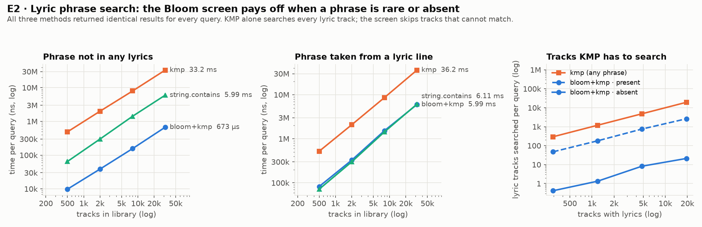
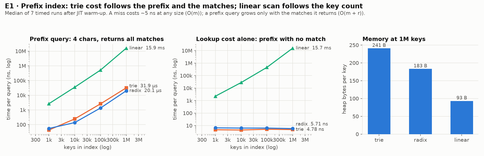

# bloombox

A terminal music player for Linux, written in Java. Its search box finds tracks by title,
artist, album **and lyrics** as you type, using tries, a Bloom filter and KMP string
matching.

bloombox is a project for *Advanced Algorithms* (CIA 3). Every data structure and
algorithm the search depends on is implemented from scratch in `core/`, has unit tests,
and is benchmarked against a simpler baseline. The [results](#benchmarks) are
reproducible from a fixed seed.

## Features

- **Search as you type** over title, artist, album and lyrics, with field filters
  (`artist:`, `al:`, `l:`) and exact lyric phrases (`"how does it feel"`). Tab completes
  the current word.
- **Synced lyrics** from `.lrc` files next to the audio, or from embedded tags. The current
  line follows the music; click a line to jump to it. Unsynced lyrics scroll with the
  track.
- **Album art** at full resolution in Kitty and Ghostty (also inside tmux), or as
  half-block characters in any other terminal.
- **Theme from the cover:** the accent and surface colours come from the album art
  (k-means++ clustering in CIELAB). Muted and black-and-white covers get matching muted
  and monochrome themes.
- **Spectrum visualizer** that follows only bloombox's own playback: an FFT of the
  playing track, in sync with the player, rather than a capture of system audio.
- **Waveform seek bar:** click anywhere on it to seek.
- **Transparent background** (optional): set *Background* to `terminal` in the settings so
  your terminal's own opacity and blur show through.
- **ReplayGain** (off / track / album) with a −12 to +12 dB pre-amp.
- **MPRIS:** media keys, `playerctl` and desktop widgets work.
- **Queue** with shuffle (Fisher–Yates) and repeat (off / all / one).
- **Fast start:** the library index is saved, so launching doesn't rescan the folder. Press
  F5 to rescan.

Supported formats: FLAC, MP3, Ogg Vorbis and Opus.

## Requirements

| | |
|---|---|
| Java 17+ and Maven 3 | to build and run |
| [mpv](https://mpv.io) | audio playback (required) |
| [ffmpeg](https://ffmpeg.org) | waveform seek bar and spectrum visualizer (optional; both are hidden without it) |
| a D-Bus session bus | MPRIS media-key support (optional) |

## Build and run

```sh
mvn package                         # builds target/bloombox.jar and runs the tests
java -jar target/bloombox.jar       # start the player
```

On first launch, open the settings with `o` and set your music folder. bloombox scans it
once and saves the library. Later launches load the saved library straight away.

Put lyrics next to the audio file with the same name: `01 Song.flac` → `01 Song.lrc` (or
`.txt` for unsynced lyrics).

### Command line

```
bloombox                            start the terminal UI
bloombox scan [DIR]                 scan a library (DIR is saved as the default)
bloombox search [OPTIONS] QUERY...  search and print the work each algorithm did
    --no-bloom    baseline: KMP every lyric track (no Bloom screening)
    --plain-trie  use the uncompressed trie instead of the radix trie
    --limit N     max results to print (default 20)
bloombox play [--shuffle] [QUERY...] headless player with MPRIS
bloombox bench [--quick] [...]      run the benchmark suite
```

## Using it

| Keys | Action |
|---|---|
| `/` | search (`Tab` completes, `Esc` clears) |
| `Enter` / double-click | play the selection |
| `Space` | play / pause |
| `n` `p` | next / previous |
| `←` `→` (`Shift` for 30 s) | seek 5 s, or click the waveform |
| `+` `-` / mouse wheel | volume |
| `s` `r` | shuffle · repeat |
| `a` | add to queue |
| `Tab` `1` `2` | Library / Queue |
| `l` | jump to the playing track |
| `F2` `i` | algorithm panel: trie nodes visited, Bloom probes, KMP comparisons for the last search |
| `o` `F10` | settings |
| `F5` | rescan the music folder |
| `F1` `?` | help |
| `q` | quit |

**Search syntax**

```
blue mon              words are prefixes, ANDed, in any field
artist:daft t:digi    restrict to title/t, artist/a, album/al, lyrics/l
"how does it feel"    exact phrase in the lyrics
```

By default, a hit found only in the lyrics plays from the start of the song. To start at
the matched line instead, turn on *Lyric hits* in the settings.

**Files:** settings are kept in `$XDG_CONFIG_HOME/bloombox/config.properties`, and the
saved library, tag cache and lyrics cache in `$XDG_CACHE_HOME/bloombox/`.

## Algorithms

All of these are in `src/main/java/bloombox/core/`.

| Where it's used | Algorithm | Cost | Baseline it's compared with |
|---|---|---|---|
| Word and prefix search | **Trie** and **radix (compressed) trie** (`trie/`) | lookup O(m), prefix query O(m + r); radix trie has ≤ 2K nodes | linear scan, O(K·m) |
| Lyric phrase search | **Bloom filter** over each track's character trigrams (`prob/`), Kirsch–Mitzenmacher double hashing | O(k) per probe; ≈ 1.44·log₂(1/p) bits per key | exact `HashSet` |
| Confirming a phrase match | **KMP** (`text/Kmp.java`) | O(n + m), ≤ 2n comparisons | naive search, O(n·m) worst case |
| Theme from the album cover | **k-means++** in CIELAB (`color/`) | O(n·k·iterations) | random seeding |
| Spectrum visualizer | **FFT**, radix-2 Cooley–Tukey (`signal/`) | O(N log N) per frame | direct DFT, O(N²) |
| Shuffle | **Fisher–Yates** (`player/PlayQueue.java`) | O(n), uniform | naive swap (biased), sort by random key O(n log n) |

How a lyric phrase query runs: the radix trie narrows the search to candidate tracks. Each
track's trigram Bloom filter then rejects tracks that can't contain the phrase, at a cost
of a few hash probes per trigram. KMP confirms the phrase only in the tracks that pass. A
Bloom filter never gives a false negative, so this returns exactly the same results as
running KMP on every track, while skipping almost all of them for rare phrases.

## Benchmarks

```sh
java -Xmx8g -jar target/bloombox.jar bench            # full run, about 6 minutes
java -jar target/bloombox.jar bench --quick           # smaller sizes, about 20 seconds
java -jar target/bloombox.jar bench --only e2,e4      # a subset of experiments
pip install matplotlib && python3 bench/plot.py       # charts for the latest run
```

Each run writes to `bench-results/<timestamp>/` (with a `latest` link):
- one CSV per experiment
- `summary.md`, with the tables, the method and the environment (JVM, CPU, heap, seed)
- a PNG and an SVG chart per experiment

Inputs are synthetic libraries generated from a seed (`--seed`, default 42), so the same
seed always produces the same data and queries. Each measurement is a median of 7 runs
after a JIT warm-up. Operation counts (nodes visited, comparisons, probes) are exact and
don't depend on the machine.

The reference run is in
[`bench-results/2026-11-20_152340/`](bench-results/2026-11-20_152340/summary.md) (Intel
Core Ultra 7 270K Plus, OpenJDK 17, seed 42). Highlights:

| Experiment | Result |
|---|---|
| E1 · prefix index, 1k → 1M keys | a lookup that misses takes ~5 ns at every size; a linear scan takes 15.7 ms at 1M keys |
| E2 · lyric phrase search, 32k tracks | absent phrase: Bloom + KMP 0.67 ms vs KMP on every track 33 ms (~49×); identical results |
| E3 · search per keystroke, 32k tracks | 1.9 ms with the radix-trie index vs 31 ms with the linear index; 112 MiB vs 282 MiB |
| E4 · Bloom filter, 1M keys, p = 0.01 | measured FPR 0.01014 vs theoretical 0.01004; 1.2 B/key vs 69 B/key for `HashSet<Long>` |
| E5 · KMP vs naive, adversarial text | 2.00 vs 64.00 comparisons per character |
| E6 · k-means++ vs random seeding | 4% vs 98% mean excess inertia over the best clustering found |
| E7 · shuffle uniformity, χ² over 40 seeds | Fisher–Yates rejected in 2/40 runs (≈ 5%, what chance predicts); naive swap in 40/40 |




Where the algorithms *don't* help is reported too:
- On ordinary text, the JDK's vectorised `String.indexOf` beats KMP on wall-clock time.
- For a common phrase, the Bloom screen is overhead, since most tracks pass it.
- The radix trie saves memory and nodes compared with the plain trie, but isn't faster
  end to end.

`summary.md` has the details.

## Tests

```sh
mvn test
```

198 JUnit 5 tests cover:
- every algorithm, with edge cases (empty input, a single element, the worst case), and
  checks against its baseline
- the LRC parser, tag reading, library scanning and caches
- settings, the playback queue and the controller
- the benchmark harness, through a smoke test

## Project layout

```
src/main/java/bloombox/
  core/      algorithms: trie/, prob/ (Bloom), text/ (KMP), color/ (k-means++), signal/ (FFT)
  index/     search engine: query parsing, per-field tries, phrase screening, ranking
  library/   scanning, tags, LRC parsing, caches, saved library
  player/    mpv backend over JSON IPC, queue, ReplayGain
  mpris/     MPRIS D-Bus service
  tui/       terminal UI (Lanterna): album art, theming, waveform, visualizer
  bench/     benchmark suite
bench/plot.py  charts for benchmark results
```

## License

[MIT](LICENSE). The dependencies keep their own licences: Lanterna and jaudiotagger are
LGPL, and dbus-java is MIT.
